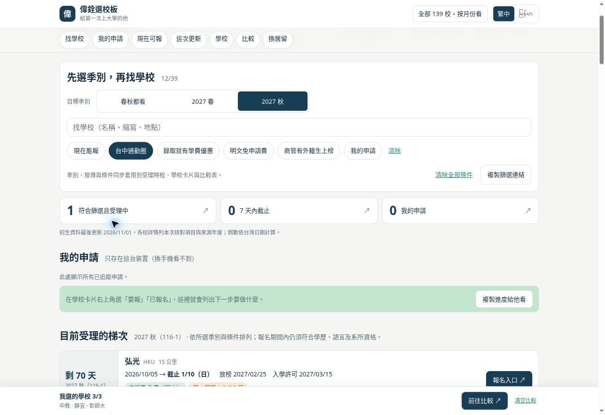

# 偉銓選校板：再次實際操作與優化

日期：2026-11-01。起點為 `b7adc6708e316d66a1645a45b9e298060b6c25d0`；延續同日39校招生資料修正，這一輪改善操作。

## 操作發現

1. 在正式網站選「台中通勤圈」，卡片與比較表剩12校，上方受理時程仍列高雄等地學校。搜尋也未同步到時程，畫面內的數量與對象不一致。
2. 春、秋季同時排列，想規劃116秋季時仍須自行排除春季；搜尋位於大量時程與更新之後，不易先縮小範圍。
3. 即將開放的梯次很多，全部展開會推遠學校卡片。
4. 固定三校後可以並排比較，卻不能直接複製成討論用摘要。新增季別後再操作一次，也抓到最近官方截止仍取兩季資料的遺漏，已修正。

## 完成行為

| 項目 | 行為 |
| --- | --- |
| 前方條件面板 | 先選春／秋／兩季，再搜尋及篩選；即時顯示符合校數，導覽增加「找學校」。 |
| 共用篩選 | 申請摘要、目前受理／即將開放／往年參考、時程圖、卡片與比較表使用同一組條件。未知學士範圍保留待查；研究所限定及不招生不算所選季別候選。 |
| 季別比較 | 下一次機會、最近官方截止及放榜欄均依所選季別；季別切換時排序改到仍可見的放榜欄。已固定三校不因搜尋消失。 |
| 梯次收合 | 先列最近3筆即將開放時程，其餘可展開，切換語言及條件保留展開狀態。 |
| 私人進度 | 我的申請顯示所有追蹤紀錄；查秋季學校時，已指定的春季梯次、下一步與備註照常保留。 |
| 比較摘要 | 複製所選三校的季別、下一次機會、費用及來源年度、語言／獎助條件、正式時程與官方連結；費用範圍、往年及未知狀態照實保留。 |
| 分享與儲存 | 季別記在本機；分享連結明確指定季別（包含兩季），覆蓋接收者的舊季別。個人狀態、申請梯次、備註與草稿不寫進連結或比較摘要。剪貼簿受阻時顯示可手動複製的欄位。 |

## 驗證

- `npm test`、`node --check dist/wq-board.js`、`node --check dist/wq-core.js`、`git diff --check` 通過。
- 新增回歸情境：選秋季＋台中僅弘光受理中、搜尋彰師大各區同為1/39、無結果不留下其他校票卡／時程帶、清除搜尋保留其他條件、清除全部條件回39校。
- 驗證春季排除東海研究所、未知範圍仍可待查、比較截止不借用靜宜春季11/15；彰師大秋季截止3/5、放榜5/21、許可5/28正確納入比較摘要。
- 朝陽春季第二梯的2027/1/15進度與備註在秋季搜尋時保留；三校摘要與連結不包含測試私人備註、狀態或所選春季梯次。剪貼簿失敗、分享後重開、舊本機季別覆蓋及緬文摘要有回歸測試。
- 透過 Chrome 操作正式網站找出問題，修正後使用受管預覽重做：秋季／通勤／搜尋、無結果恢復、固定中教／靜宜／彰師大、複製摘要、分享後重開、遠期時程收合及語言切換。
- 390px繁中、320px緬文 iframe 的真實CSS窄視窗測試：頁面沒有水平溢出，季別按鈕高度至少44px，比較區仍可獨立橫向捲動，鍵盤右鍵可推進40px。這不是實體手機／Safari驗證。
- 預覽中建立的朝陽測試進度、梯次及備註已透過介面清除；正式網站原本無選校的比較狀態也在操作後復原。

## 範圍

本輪只修改選校板的 `wq-board.js`、`wq-core.js`、`wq-board.css`、對應測試與文件。39校招生JSON及編輯資料、主站139校資料與程式都沒有改動。招生資訊沿用同日已核對快照，沒有替任何人送出學校申請。
