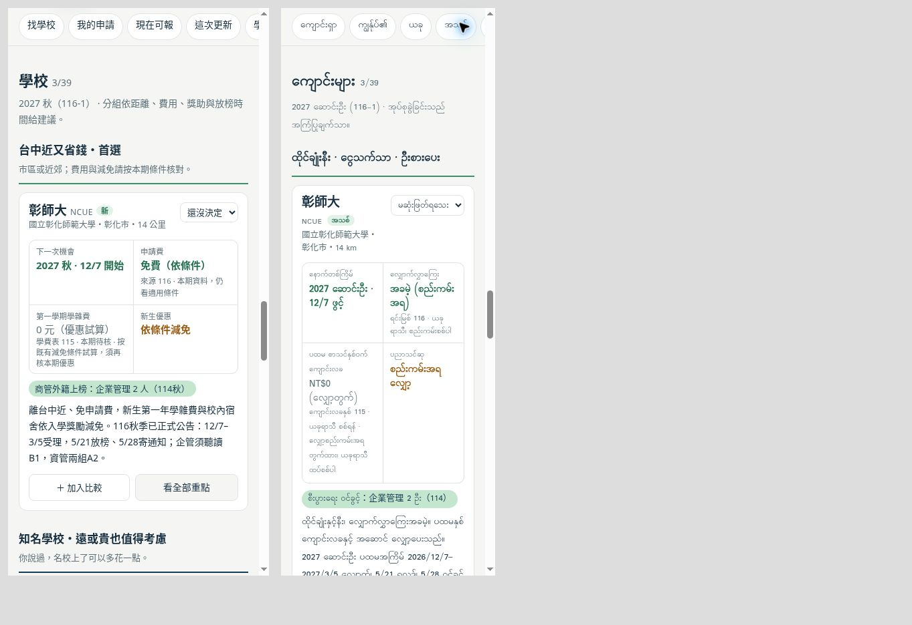

# 偉銓選校板：費用年度與申請季別

日期：2026-11-02（臺灣時間）。起點 `866ed12d748000b7f1bead70e4fc90c552f84e2a`。

## 實際操作發現

正式站選「2027秋＋明文免申請費」會列出13校，但混有115年度、115-2春季或未標季別的FAQ。學校卡片的「0元／第一年錄取就免」及「確定有」也沒有把來源年度與本期適用條件放在旁邊，容易把舊資料當成本期承諾。另發現秋季學校詳情的「原始研究資料」連結仍固定帶春季參數。

## 改善

- 春／秋單季的「本期明文免申請費」需同時符合學士招生範圍、明載免費且金額為0、可追溯的來源連結及相符來源年度。國籍等減免條件仍須核對，不判定個人資格。
- 依現有資料，116秋季保留彰師大、清華、弘光3校；兩季都看仍保留13校的免費資料，並改標「含往年」。其他學校未通過此篩選，不代表已確定收費。
- 申請費在卡片、受理時程、全部比較、固定候選比較及複製摘要都帶來源年度；不符本期的金額標為參考。兩季同時顯示時，每張時程卡依自己的季別判斷。
- 學雜費扣除既有減免後改標「優惠試算」，包含0元；其他金額標為參考。旁列學費表年度與本期待核提醒，不用綠色表示已保證減免。分組與篩選說明同步去除「確定優惠」措辭。
- 秋季的原始研究資料連結會保留秋季；春季仍連至春季。

## 驗證

- `npm test`：主站及39校既有回歸通過，新增費用季別、來源年度、無來源、學士未知／研究所限定、條件減免、固定候選保留、複製摘要、雙語及原始資料連結案例。
- JavaScript語法檢查及 `git diff --check` 通過。
- 真實Chrome操作：秋季免費3校、春季免費3校、兩季免費13校；確認卡片費用說明，實際點擊秋季原始資料連結並核對落地季別。
- 390px繁中與320px緬文iframe實測，內部內容寬375／305px且無水平溢出；窄版切換免費篩選後維持正確校數。這是響應式瀏覽器測試，未測實體手機或Safari。

## 範圍

限偉銓39校費用判讀與季別操作。招生資料仍為2026-11-01查核快照；本次沒有重新查核39校或改動招生JSON、主站139校資料及私人申請進度。
