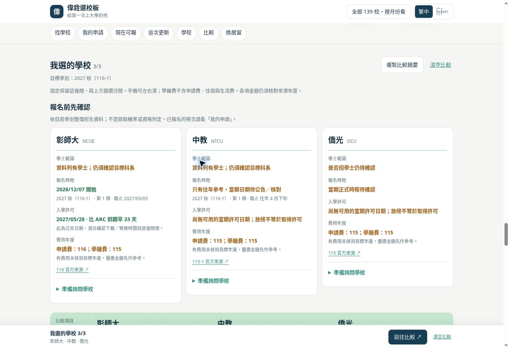

# 偉銓選校板：把比較結果變成報名前的下一步

日期：2026-11-02（臺灣時間）。起點 `93cd72174b2da0ded507f00c3c0ca442483efa56`。

## 實際操作發現

在正式站固定彰師大、中教、僑光，切到116秋季：並排表雖有來源年度，仍須自行整理哪一項尚未確認。尤其彰師大的116申請費與115學費優惠並列，容易將舊年度的0元當成新年度承諾；中教只有往年秋季日期，僑光的春季正式梯次則不適用秋季。選定學校之後，也缺少把疑問整理給招生單位的入口。

## 改善

- 每間固定候選校增加「報名前先確認」：學士範圍、同一梯次的報名時程、入學許可、費用來源年度。
- 研究所限定、未知學士範圍、開放日未知、往年／衝突資料、全部已截止，保留各自的狀態。兩季都看時先選一季，再顯示檢查。
- 許可日期與放榜分開。僅官方確切許可日計算距既有ARC到期日的天數；往年日期不升格成今年保證。少於30天標示時間緊，晚於到期標示風險，公告日期仍須確認下載／寄達時間。
- 費用年度採保守比對。「115參考；116待核」不算116已確認；學雜費與獎助的舊年度金額標為參考，公開比較摘要也帶上提醒。
- 「準備詢問學校」顯示既有語言條件，可輸入想讀的科系，產生招生單位可讀的中文草稿。涵蓋科系招生、申請／補件期限、TOCFL各項、學歷文件、費用／獎助與許可取得方式。
- 草稿可修改、重新產生及複製，按學校與季別存在本機；搜尋、語言切換、重開頁面保留內容。分享連結與公開比較摘要不帶入科系或私人草稿，沒有自動寄信功能。

## 驗證

- `npm test`：既有主站與39校測試通過，新增檢查規則及草稿互動測試通過。
- 語法檢查與 `git diff --check` 通過。
- 真實Chrome預覽操作：加入三校、切季別、填科系、產生草稿、自行修改、複製、重新載入、分享連結與摘要；確認草稿保留及私人內容未進公開分享。
- 390px繁中及320px緬文iframe測試（內部內容寬375／305px）：檢查卡片及展開的草稿表單無水平溢出，產生按鈕高44px；緬文介面仍生成給學校的中文草稿。未測實體手機或Safari。
- 對歷年許可、晚到許可、接近到期、研究所限定、舊費用、官方來源衝突、剪貼簿受阻、儲存失敗與HTML輸入做回歸測試。

## 範圍

限偉銓39校選校流程；招生資料仍沿用2026-11-01查核快照，本次沒有宣稱重新查核39校。主站139校資料、既有私人申請進度與招生JSON沒有修改。
